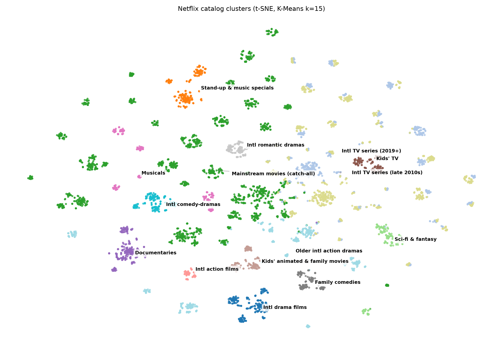
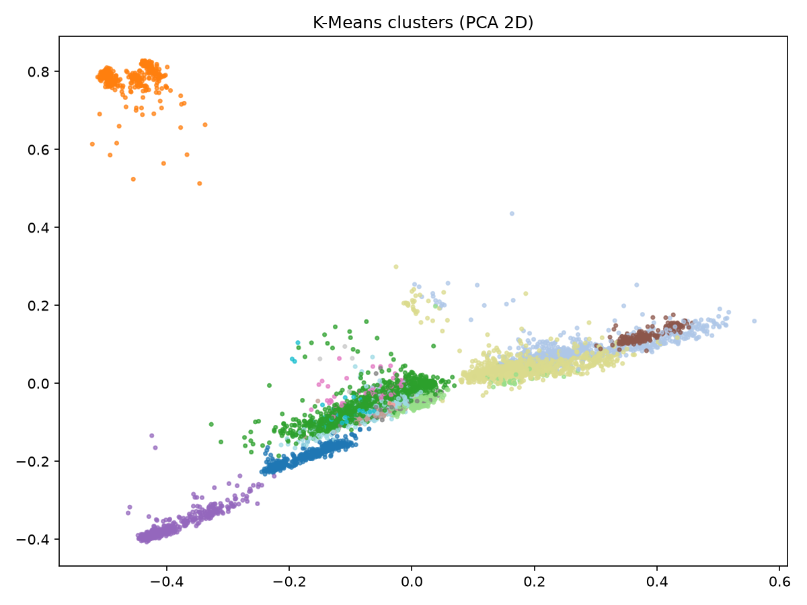
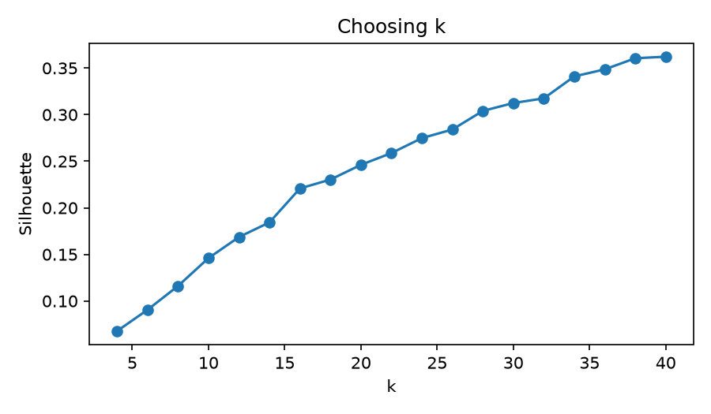
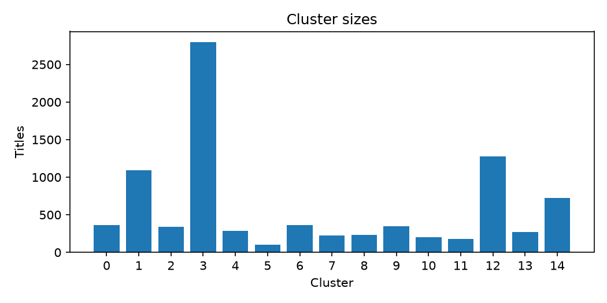

# Netflix Content Clustering

Unsupervised segmentation of the Netflix catalog. I grouped 8,807 movies and TV shows into 15 clusters using their descriptions, genres and release era, then profiled and named each cluster to see what hidden content patterns show up.



## Approach

1. **Text feature:** description + genres (repeated twice to up-weight them) + type + a release-era token. Multi-word genres are underscore-joined so each stays a single token.
2. **TF-IDF:** unigrams and bigrams, 8,000 features, sublinear term frequency.
3. **Dimensionality reduction:** TruncatedSVD (PCA for sparse data) to 100 components, then L2 normalisation.
4. **Choosing k:** silhouette score for k = 4 to 40 (see Limitations).
5. **Clustering:** K-Means and Agglomerative (Ward), compared with silhouette and Adjusted Rand Index.
6. **Profiling:** size, % TV shows, median release year, top genres, top TF-IDF terms and sample titles per cluster, then manual naming.

## Results

k = 15. Both methods give similar scores and mostly agree on the structure:

| Metric | Value |
|---|---|
| K-Means silhouette | 0.197 |
| Agglomerative silhouette | 0.209 |
| Adjusted Rand Index (K-Means vs Agglomerative) | 0.60 |

K-Means clusters (names assigned manually from the profile table):

| # | Cluster | Titles | % TV | Median year | Top genres | Examples |
|---|---|---|---|---|---|---|
| 0 | International drama films | 362 | 0 | 2016 | Dramas, International Movies | Caregiver, Bombay Talkies |
| 1 | Recent international TV series (2019+) | 1,095 | 100 | 2020 | International TV Shows, TV Dramas, TV Comedies | Historical Roasts, Paranormal |
| 2 | Stand-up and music specials | 343 | 0 | 2017 | Stand-Up Comedy, Music & Musicals, Documentaries | Ali Wong: Baby Cobra |
| 3 | Mainstream movies (catch-all) | 2,799 | 0 | 2017 | International Movies, Dramas, Comedies | Splatter, The Red Sea Diving Resort |
| 4 | Sci-fi and fantasy | 289 | 28 | 2015 | Sci-Fi & Fantasy, Action & Adventure | Next Gen |
| 5 | International action films | 101 | 0 | 2016 | Action & Adventure, International Movies | Sky on Fire |
| 6 | Feature documentaries | 359 | 0 | 2017 | Documentaries | Jeremiah Tower: The Last Magnificent |
| 7 | Kids' TV series | 223 | 100 | 2017 | Kids' TV, TV Dramas, British TV Shows | Shopkins, Miniforce: Super Dino Power |
| 8 | Kids' animated and family movies | 229 | 0 | 2017 | Children & Family Movies, Anime Features | Xico's Journey |
| 9 | Musicals and music-driven films | 348 | 0 | 2016 | Music & Musicals, International Movies | Barbie Princess Adventure, Race 2 |
| 10 | Family comedies | 204 | 0 | 2016 | Children & Family Movies, Comedies | Bedtime Stories, Zoom |
| 11 | International romantic dramas | 180 | 0 | 2017 | Dramas, International Movies, Romantic Movies | Zindagi Kitni Haseen Hay, A Beautiful Life |
| 12 | International TV series (late 2010s) | 1,276 | 100 | 2016 | International TV Shows, TV Dramas, TV Comedies | 100 Days My Prince |
| 13 | International comedy-dramas | 274 | 0 | 2016 | Comedies, Dramas, International Movies | Cycle, Kuch Kuch Hota Hai |
| 14 | Older international action dramas | 725 | 0 | 2012 | Action & Adventure, International Movies, Dramas | Asoka, Singham |

### Findings

- **Type dominates.** All clusters except sci-fi and fantasy are 0% or 100% TV, so movies and TV shows almost never mix.
- **Era splits similar content.** Clusters 1 and 12 have nearly the same genre mix. What separates them is the release era (2019+ vs late 2010s).
- **Niche formats form clean clusters.** Stand-up specials, documentaries and kids' TV each get their own tight group.
- **A large catch-all exists.** Cluster 3 holds about a third of the catalog, mainstream late-2010s movies that don't separate by genre.

### Plots

| | |
|---|---|
|  |  |
| K-Means clusters, PCA 2D | Silhouette vs k |



## Limitations

- **k was chosen by interpretability, not by silhouette.** The silhouette score rose steadily from 0.07 at k=4 to 0.36 at k=40 with no peak or elbow, so it couldn't pick k. I settled on k=15 because that is where clusters stayed distinct and nameable.
- **The structure is driven mostly by metadata.** Genres are up-weighted and type and era are included as tokens, so clusters follow those fields more than the meaning of the descriptions. The t-SNE plot shows the larger clusters broken into many small islands, which likely reflect shared genre combinations.
- **One cluster is a catch-all.** Cluster 3 (2,799 titles) is too broad to be a sharp insight.
- **Names are subjective.** I assigned them by hand from top genres, top terms and sample titles.
- **t-SNE distances are not meaningful.** The plot shows which titles group together, not how far apart clusters are.
- **No stability analysis.** Results use one fixed random seed.

## Run it

```bash
pip install -r requirements.txt
```

1. Download `netflix_titles.csv` (see `data/README.md`) into `data/`.
2. Open `notebooks/clustering.ipynb` and run the cells top to bottom.
3. Plots are saved to `images/` and tables to `outputs/`.

## Project structure

```
netflix-content-clustering/
├── data/           # dataset instructions (raw CSV not committed)
├── notebooks/      # clustering.ipynb, the full analysis
├── src/            # preprocessing, features, clustering and profiling code
├── images/         # plots used in this README
└── outputs/        # cluster_profile.csv, netflix_clustered.csv
```

## Next steps

- Replace TF-IDF with sentence-transformer embeddings and compare the clusters.
- Lower the genre weighting, or drop the type and era tokens, so clusters follow description themes more.
- Add a "find similar shows" function using cosine similarity.

## Tech

Python, pandas, NumPy, scikit-learn, matplotlib, Jupyter

## Data

Netflix Movies and TV Shows (Flixable) on Kaggle: https://www.kaggle.com/datasets/shivamb/netflix-shows
