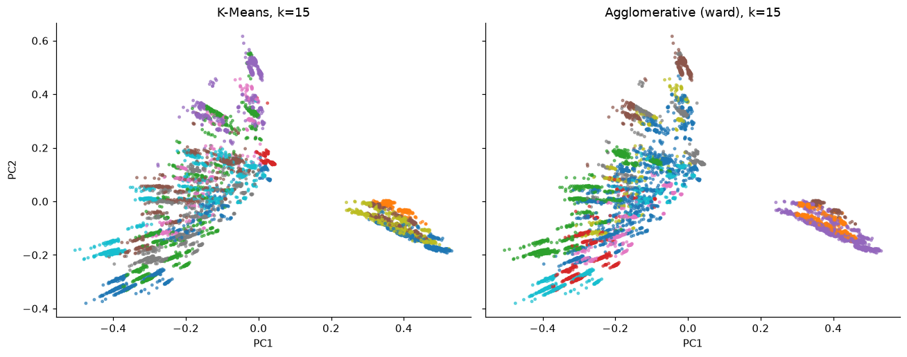
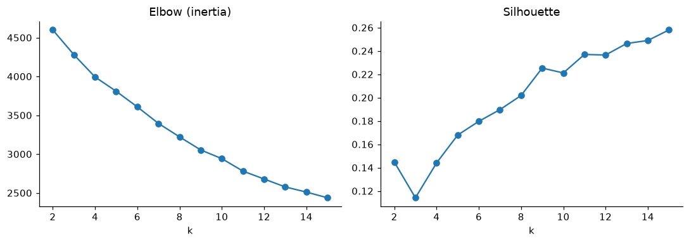
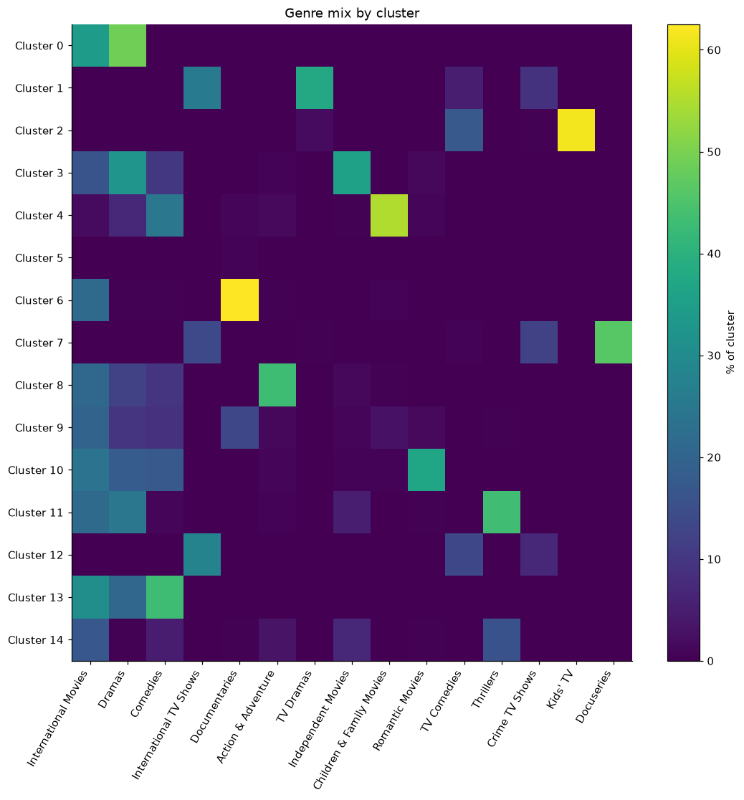

# Netflix / OTT Shows Clustering & Segmentation

Unsupervised learning on the Netflix catalog: group 8,807 movies and TV shows into content clusters using text features (descriptions, genres) plus release year and type, to discover hidden patterns in the catalog.



## Highlights

- **8,807 titles** clustered into **15 groups** without using genre labels as ground truth
- **K-Means (silhouette 0.258) beat Agglomerative/Ward (0.228)**; the two methods agree moderately (adjusted Rand index 0.645)
- Clear clusters emerge: stand-up comedy, horror, true-crime docuseries, kids' & anime TV, international TV dramas, romantic movies and more

## Approach

1. **Clean:** drop duplicates, fill missing text fields, fix rating values that are actually durations.
2. **Features:** TF-IDF on descriptions (unigrams + bigrams) and on genres (each `listed_in` entry as one token), one-hot `type` and `rating`, min-max scaled `release_year`. Block weights are configurable.
3. **Reduce:** TruncatedSVD (LSA) to 100 dimensions (56% variance retained), the sparse-friendly counterpart of PCA, then L2-normalise. PCA is used only for the 2D plots.
4. **Cluster:** K-Means and Agglomerative (Ward), with k chosen from elbow and silhouette curves.
5. **Compare:** silhouette, Davies-Bouldin, Calinski-Harabasz, and adjusted Rand index between methods.
6. **Interpret:** top terms, genre mix, TV/movie split, median release year and example titles per cluster; 2D projection; nearest-neighbour "similar titles" lookup.

## Dataset

[Netflix Movies and TV Shows](https://www.kaggle.com/datasets/shivamb/netflix-shows) (Flixable, via Kaggle), about 8.8k titles. Download `netflix_titles.csv` and place it at `data/netflix_titles.csv`, or set `NETFLIX_CSV=/path/to/file.csv`.

## Run

```bash
pip install -r requirements.txt
python netflix_clustering.py
# options: --data PATH --k 15 --components 100 --similar "Some Title"
```

Outputs: figures in `figures/`; `netflix_clustered.csv`, `cluster_profiles.csv` and `model_metrics.csv` in `data/`.

## Results

### Model comparison (k = 15)

| Method | Silhouette | Davies-Bouldin (lower is better) | Calinski-Harabasz |
|---|---|---|---|
| **K-Means** | **0.258** | **1.688** | **741.5** |
| Agglomerative (Ward) | 0.228 | 1.910 | 677.3 |

Adjusted Rand index between the two: 0.645.

### Clusters (K-Means)

| Cluster | Size | Top genres | Example titles |
|---|---|---|---|
| Stand-up comedy specials | 342 | Stand-Up Comedy, Music & Musicals | Jeff Dunham: Arguing with Myself |
| Horror movies | 357 | Horror, Thrillers | Crimson Peak, Silent Hill: Revelation |
| Docuseries & true crime | 395 | Docuseries, Crime TV, Reality TV | The Irish Mob |
| Documentaries | 724 | Documentaries, Sports Movies | Iverson |
| Music & musical documentaries | 358 | Music & Musicals, Documentaries | I Called Him Morgan |
| Kids' & anime TV | 450 | Kids' TV, TV Comedies, Anime | LEGO Ninjago, Yo-Kai Watch |
| Family & kids' movies | 587 | Children & Family, Comedies | Open Season |
| International TV dramas & crime | 747 | TV Dramas, Crime TV | The Rain |
| International TV comedy, romance & reality | 1,084 | TV Comedies, Romantic TV | Get Even |
| Romantic movies | 561 | Romantic, International | Single |
| Thrillers | 446 | Thrillers, Dramas | Interrogation |
| International comedies | 667 | Comedies, International | Your Excellency |
| Action & cult movies | 770 | Action & Adventure, Cult | The Matrix, V for Vendetta |
| Indie dramas | 604 | Independent, Dramas | Almost Love |
| Dramas, sports & faith movies | 715 | Dramas, International | A Way Back Home |

### Figures

| | |
|---|---|
|  |  |

## Limitations

- Silhouette was still rising at k = 15, the top of the tested range, so k = 15 was chosen for interpretability rather than as a true optimum.
- Genre features dominate the description text in the cluster terms. Broad "international drama/comedy" movies stay blurry because their genres and descriptions overlap heavily.
- Silhouette scores around 0.2 are typical for sparse text data; clusters are best read as soft themes, not hard categories.

## Next steps

- Sentence-transformer embeddings instead of TF-IDF
- HDBSCAN for density-based clusters
- Tune the genre/description weights and extend the k range
- Add `country`, `cast` and `director` features
